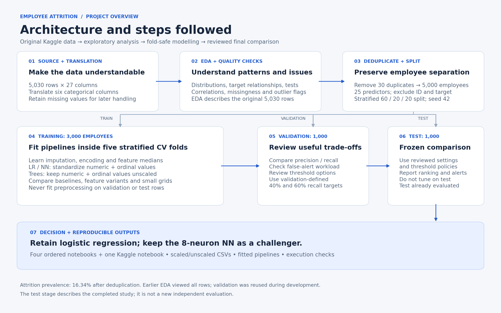

# Employee Attrition Analysis

Employee attrition prediction to help HR prioritise retention conversations, comparing predictive performance with model complexity and computation time.

**Recommended candidate: logistic regression.** A small neural network offered no clear test-performance advantage.

[View the 7-slide presentation](results/presentation/Employee_Attrition_Project_Showcase_Revised.pptx)

## Data and approach

[Kaggle dataset](https://www.kaggle.com/datasets/yangjiu/employee-attrition-early-warning-dataset/data): **5,000 employees, 25 predictors, 16.34% attrition**. Preparation removed 30 duplicates and translated six categorical columns into English.

EDA, statistical tests and feature experiments informed comparisons of dummy, logistic regression, decision tree, random forest and neural-network models.

Stratified **60/20/20 splits**, preprocessing inside **5-fold cross-validation**, and validation-defined thresholds support the final test comparison.



## Key findings

| Final candidate | CV AP | Test AP | Test ROC-AUC | Parameters |
|---|---:|---:|---:|---:|
| Logistic regression | 0.3308 | 0.2695 | 0.7078 | 40 |
| Neural network, 8 neurons | 0.3184 | 0.2746 | 0.7100 | 329 |

AP means average precision; higher scores indicate better ranking across precision-recall trade-offs.

- **Model choice:** logistic regression had stronger CV AP and faster fitting. The NN's small test gain was uncertain: its 95% bootstrap interval included zero.
- **Features:** engineering and removals gave inconsistent gains, so final candidates retain the original predictors.
- **HR value:** one frozen policy flagged 210 employees, identifying 65 leavers with 145 false alerts, versus about 34 leavers expected from random selection. Retention savings require a pilot.

Findings are exploratory. Validation was reused, and the test set is already evaluated. Further tuning needs fresh evaluation data.

## Run the project

Use Python **3.11** (checked with **3.11.4**):

```bash
conda create -n attrition python=3.11.4
conda activate attrition
python -m pip install -r requirements.txt
python -m jupyter lab
```

Download the Kaggle CSV into `data/raw/`; follow the [data setup instructions](data/README.md).

| Notebook | Purpose |
|---|---|
| [1. EDA](01_EDA.ipynb) | Translate data, explore distributions and statistical relationships |
| [2. Preprocessing](02_Feature_Engineering_and_Preprocessing.ipynb) | Create splits and scaled/unscaled feature variants |
| [3. Modelling](03_Modelling_and_Experiments.ipynb) | Repeat baselines, tuning and feature experiments |
| [4. Final evaluation](04_Final_Models_and_Test_Inferences.ipynb) | Reproduce frozen predictions and final comparisons |

For final results, run Notebook 1's setup, Notebook 2, then Notebook 4. Notebook 3 is optional and repeats training/searches.

Frozen model dependencies are included. Raw data, generated CSVs and temporary files stay outside Git. [Reproduction checks](EXECUTION_CHECK.md) passed in the pinned environment; installation on a new machine remains untested.

[Statistical findings](results/figures/02_statistical_findings.png) · [Model-selection diagram](results/figures/03_experiments_and_model_selection.png) · [Processed-data guide](data/preprocessed/README.md)
