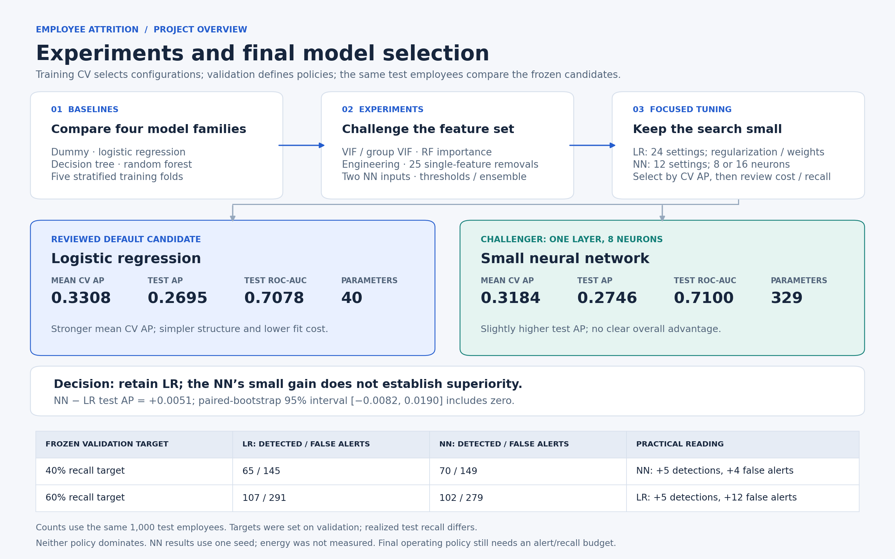

# Employee attrition: analysis, experiments and model selection

This project investigates whether employee records can help identify attrition risk, and whether a more complex model provides a useful improvement over logistic regression. It covers data preparation, exploratory statistics, feature experiments, model tuning and a final comparison of detection performance against computational cost.

**Main finding:** retain logistic regression as the default candidate and the small neural network as a challenger. The NN's slightly higher test average precision did not establish a clear advantage. An operating threshold still depends on the acceptable balance between missed leavers and false alerts.

[Project presentation](results/presentation/Employee_Attrition_Project_Showcase_Revised.pptx) explains the statistics, experiments, computation trade-offs and business implications in seven slides.

## Reproduce the project

Use Python **3.11**; the frozen artifacts were created and checked with **3.11.4**. The package versions in [requirements.txt](requirements.txt) match the checked environment. For example, from the cloned repository root using Conda:

```bash
conda create -n attrition python=3.11.4
conda activate attrition
python -m pip install -r requirements.txt
python -m jupyter lab
```

Download `employee_attrition_data.csv` from the linked Kaggle dataset and place it in `data/raw/`. Follow the [data setup instructions](data/README.md). No Kaggle credentials belong in the repository.

- Run the setup cells of **Notebook 1** to create and verify the English translation. Continue through the notebook for EDA.
- Run **Notebook 2** to regenerate the fixed splits and all preprocessing variants, including separate tree inputs.
- Run **Notebook 4** to reproduce the frozen final comparison without training models again. Its required models, probability caches and evaluation plan are included.
- Run **Notebook 3** when you want to repeat the modelling experiments and hyperparameter searches. This step takes longer and is optional for viewing the final comparison.

Open notebooks from the repository root. The original folder name is not required. Saved plots and results remain visible on GitHub without running code. Downloaded and generated data stays local.

## Dataset and prediction task

Source: [Kaggle employee attrition early-warning dataset](https://www.kaggle.com/datasets/yangjiu/employee-attrition-early-warning-dataset/data), version 1.

| Item | Details |
|---|---|
| Original data | 5,030 rows and 27 columns |
| Modelling data | 5,000 employees after removing 30 exact duplicates |
| Target | attrition: 1 = leaves, 0 = stays |
| Positive class | 817 leavers, or 16.34% of the deduplicated data |
| Predictors | 25 original predictors; employee ID and target are excluded |
| Language preparation | Chinese values in six categorical columns translated into English |

Predicting that everyone stays would achieve about 84% accuracy. We therefore assess how well models rank and detect leavers, together with the workload created by false alerts.

## 1. Architecture and steps followed


The sequence separates understanding the data from learning transformations and comparing models. Each stage answers a question before adding complexity.

| Stage | What we did | Why we did it |
|---|---|---|
| Understand the source | Translated categories; examined distributions, missingness, target relationships and outliers | Understand the fields before choosing transformations or models |
| Validate records | Removed exact duplicates; reviewed inconsistent time fields and plausible outliers | Avoid counting employees twice while avoiding unsupported corrections |
| Separate the data | Fixed, stratified 60/20/20 train/validation/test split; seed 42 | Preserve class proportions and compare experiments on the same employees |
| Prepare predictors | Learned imputers, encoders and scalers from training rows | Prevent validation/test information from influencing fitted transformations |
| Compare experiments | Same five stratified training-CV folds, followed by validation comparisons | Check whether a change improves prediction beyond one favourable fit |
| Freeze the final comparison | Reviewed model settings and validation-defined thresholds applied to test | Evaluate selected policies without adjusting them to test outcomes |

The split contains 3,000 training employees (490 leavers), 1,000 validation employees (164 leavers), and 1,000 test employees (163 leavers).

### Why preprocessing differs by model

Numerical missing values use the training median. Nominal categories use an explicit Missing value, while education and travel frequency use their stated order and training-mode imputation. Plausible outliers and unresolved time-field flags remain unchanged.

LR and NN use standardized numerical and ordinal inputs. Trees use unscaled inputs; one-hot indicators remain 0/1. Early baselines retain full one-hot encoding (43 inputs). Later reference encoding drops one category per nominal predictor (39 inputs), avoiding redundant indicators in the linear-model analysis.

Unseen nominal categories map to all-zero indicators, sharing the reference representation when a category is dropped. Unseen ordinal categories map to -1 before optional scaling.

**CV and searches always start from raw training rows with preprocessing inside the pipeline.** Exported transformed CSVs support fixed-split work; using their training-wide transformations directly in CV would allow information from held-out folds into preprocessing. Relative-salary medians are also learned separately within each training fold.

## 2. What the statistical analysis taught us

[View the statistical findings diagram](results/figures/02_statistical_findings.png)

The checks generated hypotheses to test through modelling. They were not automatic rules for keeping or removing predictors.

| Evidence | Interpretation and resulting decision |
|---|---|
| Salary and overtime differed between leavers and stayers in the Welch examples | Investigate these predictors; association does not establish why employees leave |
| Travel had a weak association with attrition; department had no clear evidence at the adjusted 5% level | Statistical significance and predictive usefulness are different questions; test usefulness through models |
| Maximum VIF was 31.44; the joint job-level/salary likelihood-ratio test had p approximately 0.0001 | Related predictors can share information. Compare group tests and regularized model stability before removing them |
| Removing both salary and job level reduced CV and validation AP | High VIF alone did not justify discarding both; regularization offered a way to retain their information |
| RF importance highlighted satisfaction and salary; removing job or environment satisfaction reduced CV AP in every fold | Cross-check model-specific importance with removal experiments |
| Interactions improved CV AP by 0.0011 but reduced validation AP by 0.0028 | Added features did not provide a consistent improvement |
| Removing three predictors moved validation AP from 0.2916 to 0.2925 | The gain was too small to establish a better model; retain the reduced version as an experiment |

The eight hypothesis-test examples include one-sample t-tests, Welch two-sample t-tests, chi-square tests and ANOVA, with Holm adjustment. One-sample benchmarks are illustrative. Historical EDA includes duplicates, and independence and ANOVA assumptions were not fully established. These findings are exploratory rather than confirmatory or causal.

## 3. Modelling, experimentation and the final choice



We began with a dummy classifier, logistic regression, decision tree and random forest. The dummy established a trivial reference; the other models tested whether linear or tree-based relationships improved prediction. Initial tuning used grid search for LR and decision tree, and randomized search for random forest.

We then challenged the feature set through interactions, log transformations, relative salary, 25 individual predictor removals and selected combinations. Additive engineered variants kept their originals; explicitly named replacement/removal variants tested whether those originals could be omitted.

Two small NN baselines compared original predictors against originals plus both dissatisfaction interactions and relative salary. We also examined thresholds and an equal-weight probability ensemble. Some validation operating points improved, but engineered/ensemble alternatives did not show a consistent advantage across CV and precision–recall trade-offs, so they remained experiments.

The focused tuning stage retained LR and the original-predictor NN:

- **LR:** 24 configurations covering regularization strength, penalty and class weighting.
- **NN:** 12 configurations covering one hidden layer of 8 or 16 neurons, regularization, learning rate and stopping behaviour.
- **Selection:** average precision (AP) was the main training-CV score. Validation precision, recall and false-alert counts assessed practical usefulness. ROC-AUC, parameter counts and measured fitting/prediction time provided supporting evidence.

We kept the CV winner and a reviewed economical alternative within 0.005 AP of that winner. This is a practical tolerance, not a significance test. Reviewed alternatives are recorded so timing fluctuations cannot silently change which models are compared; they must still satisfy the CV tolerance on rerun.

### Final evidence and reasoning

| Reviewed candidate | Mean training-CV AP | Test AP | Test ROC-AUC | Parameters |
|---|---:|---:|---:|---:|
| Logistic regression | 0.3308 | 0.2695 | 0.7078 | 40 |
| Small NN: one layer, 8 neurons | 0.3184 | 0.2746 | 0.7100 | 329 |

The NN's test AP advantage was 0.0051. The approximate paired-bootstrap 95% interval for the difference was **[-0.0082, 0.0190]**, which includes zero. This sample did not establish a clear NN AP advantage.

Neither model dominated both frozen policies. At the validation-40% policy, the NN detected five more test leavers with four more false alerts. At the validation-60% policy, LR detected five more with twelve more false alerts. These labels describe validation recall targets; actual test recall differs, so these are not comparisons at exactly equal test recall.

**Decision:** retain LR for its stronger mean CV AP, simpler structure and lower observed fitting cost. Keep the 8-neuron NN as a challenger if its operating trade-off is useful. Both retain the original 25 predictors with scaled reference encoding. No operating policy has been chosen without a recall/alert budget, and electrical energy consumption was not measured.

## Notebook guide and execution

Open the four notebooks in numbered order. Each has its own imports and paths and needs no variables from another kernel.

1. [EDA](01_EDA.ipynb): quality, distributions, target relationships, correlations, outliers and hypothesis-test demonstrations.
2. [Feature engineering and preprocessing](02_Feature_Engineering_and_Preprocessing.ipynb): deduplication, splits, transformations, feature variants, training-only collinearity diagnostics and exports.
3. [Modelling and experiments](03_Modelling_and_Experiments.ipynb): baselines, tuning, importance/stability checks, feature experiments, NN cases, thresholds, ensemble comparisons and focused tuning.
4. [Final models and test inferences](04_Final_Models_and_Test_Inferences.ipynb): frozen LR/NN comparison, saved predictions, uncertainty and model exports.

The original assignment and standalone Kaggle notebooks remain outside this curated repository. The four notebooks above provide the published workflow.

The [manifest](artifacts/manifest.json) records the original schema, versions and data hashes. Notebook 2 refreshes the generated-file manifest locally. Notebook 4 checks split hashes, row alignment and frozen validation predictions before evaluating the saved test scores.

Run Notebook 2 before Notebooks 3 or 4 in a fresh clone. Notebook 4 does not require running Notebook 3 first because its frozen dependencies are included. Experimental reruns write to artifacts/experimental_runs, keeping frozen final-comparison assets separate.

## Data, outputs and supporting evidence

| Location | Contents | GitHub selection |
|---|---|---|
| [data setup](data/README.md) | Download location, translation and source hashes | Included |
| data/raw | Downloaded source and verified English translation | Local only |
| data/splits | Raw predictors, targets and employee membership aligned by row_id | Generated by Notebook 2 |
| [data/preprocessed](data/preprocessed/README.md) | 11 variants, each with train/validation/test CSVs | Catalog explanation included; 33 CSVs generated locally |
| artifacts/preprocessing | Training-fitted preprocessing transformations | Generated by Notebook 2 |
| artifacts/models/focused_tuned_models.joblib | Frozen candidates used by Notebook 4 | Included |
| artifacts/scores | Frozen focused-validation and final-test probability caches | Only these two required files included |
| artifacts/final | LR candidate, NN challenger and policy options accepting raw English predictors | Included |
| artifacts/manifest.json | Schema, split/variant definitions, versions and data hashes | Included |
| artifacts/reviewed_economical_parameters.json and artifacts/test_evaluation_plan.json | Reviewed tuning alternatives and frozen policies | Included |
| results/tables | Final aggregate ranking and decision tables | Included; row-level prediction CSV excluded |
| [figures and notes](results/figures/README.md) | Three project diagrams in PNG and SVG | Included |
| results/presentation | Revised seven-slide project presentation | Revised PPTX only |

Temporary audit caches, historical duplicate tables, experimental reruns, presentation drafts, unused image assets, credentials and local environments are excluded by [.gitignore](.gitignore). They remain in the local workspace. The compact [verification record](artifacts/verification.json) and [execution findings](EXECUTION_CHECK.md) are included.

Full one-hot and reference-encoded tree variants are saved separately. Engineered/reduced exports remain labelled as experiments. Do not pass transformed CSVs into final pipelines, which include preprocessing. Serialized artifacts are version-dependent and should be loaded only from a trusted source.

## Verification and limitations

Before GitHub packaging, all four notebooks ran sequentially in fresh Python processes through IPython: **96 code cells**, with no remaining errors. **730 numeric comparisons** matched the original saved tables within display precision. Reviewed candidates reproduced original validation probabilities to floating-point precision; freshly refitted final candidates reproduced original test probabilities. All 33 processed CSVs passed transformation, row-alignment and column-order checks. Packaging adds one data-translation setup cell and output-folder creation without changing modelling or thresholds.

The audit corrected an unnecessary CSV rewrite after a transient access error and made economical-candidate selection stable across timing fluctuations. Model/feature results and frozen test policies were preserved. See [execution findings](EXECUTION_CHECK.md) and [the verification record](artifacts/verification.json). Separate Jupyter UI/kernel launch was not tested.

The original assignment notebook remains in the local archive and is not required to run the published notebooks. The diagrams document existing results; they introduced no model changes or retraining.

For GitHub packaging, a separate copy containing only the selected repository files was checked in the existing pinned Python environment. Using the downloaded source, Notebook 1 recreated the English CSV byte-for-byte, Notebook 2 regenerated all 33 processed CSVs, Notebook 3's startup cells loaded successfully, and all nine code cells of Notebook 4 reproduced the final metrics with frozen test-prediction verification enabled. Full searches were not repeated. Installing the environment from scratch on another machine remains untested.

Interpret the findings within these limits:

- Earlier EDA viewed the full dataset, and validation was inspected repeatedly.
- Feature searches and tuning make winning CV scores optimistic; fold wins are descriptive, not significance tests.
- NN results use one initialization seed; stability across seeds remains untested.
- The test set has already been evaluated. Further changes must not be optimized against its results.
- Runtime depends on the environment; parameter counts and CPU/wall time do not measure electricity use.

The completed study supports LR as the default candidate. Choosing an alert budget, deployment packaging and genuinely independent future evaluation are separate decisions.
